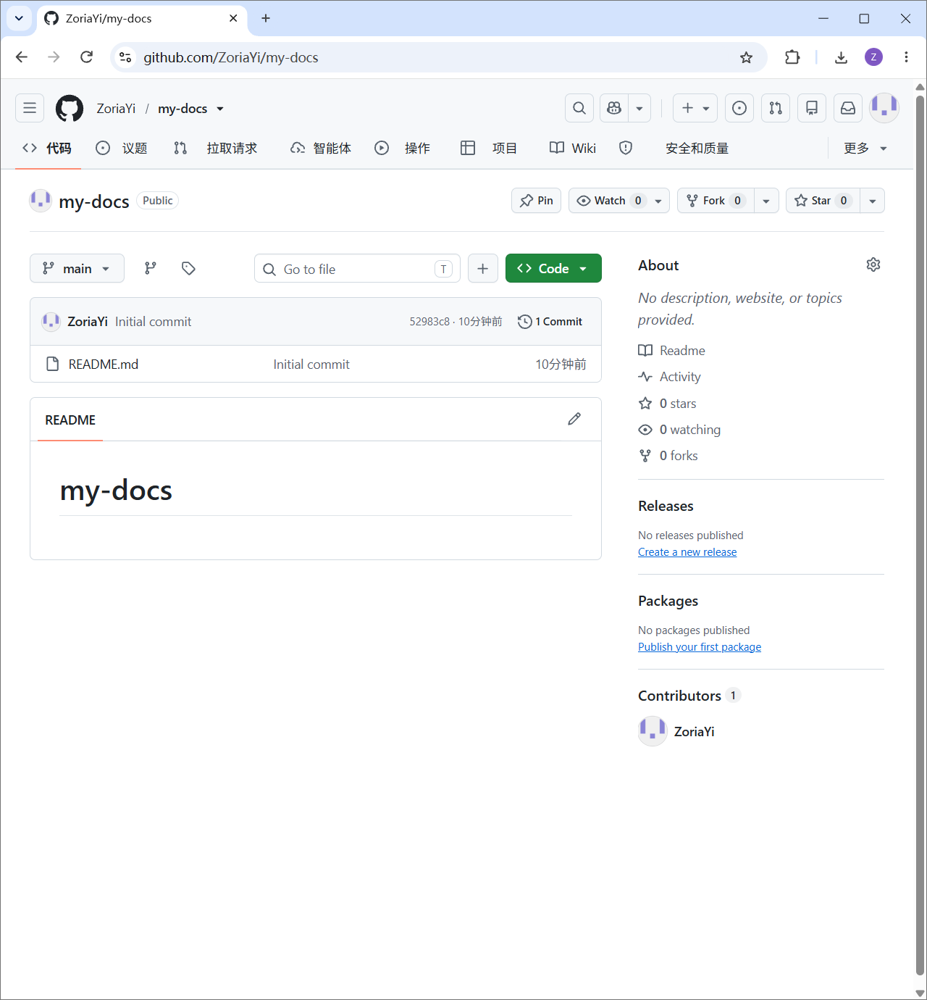
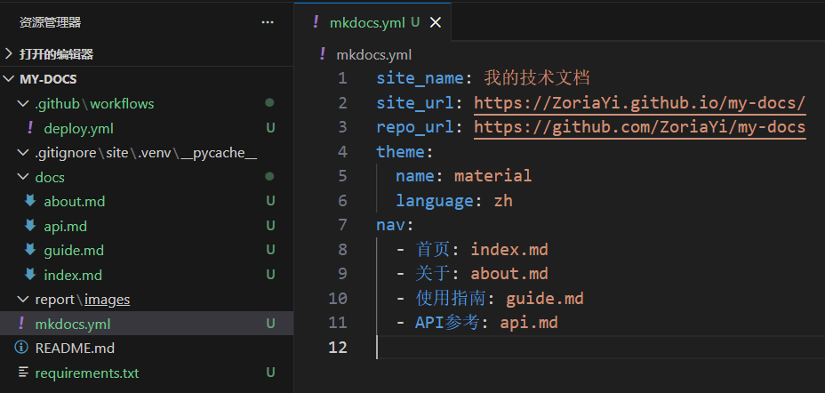
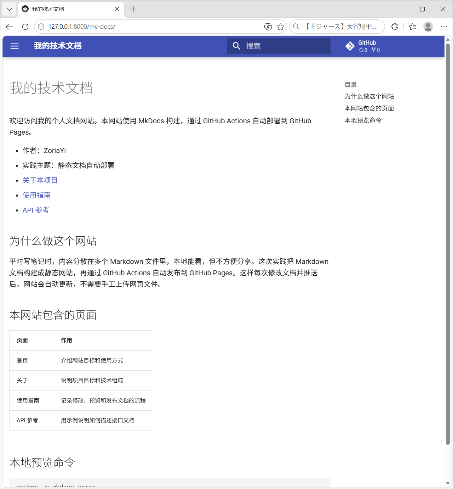
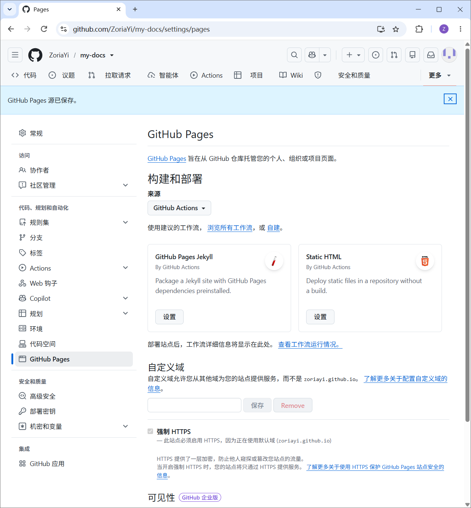
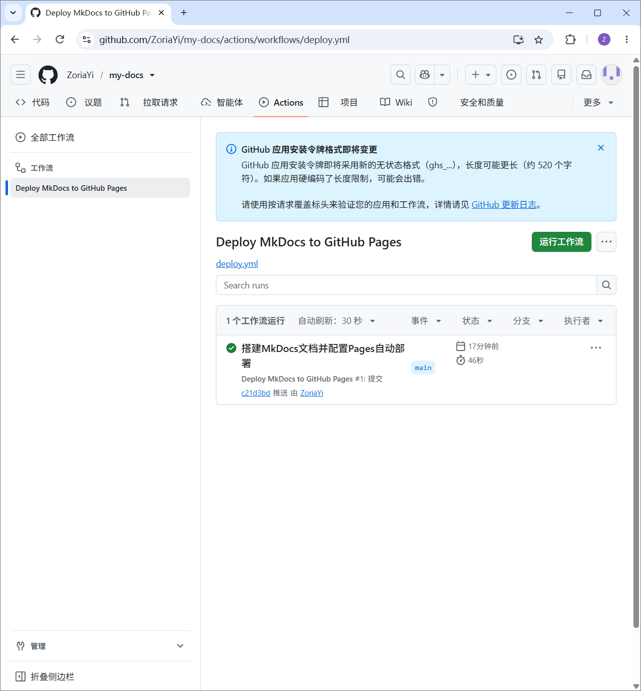
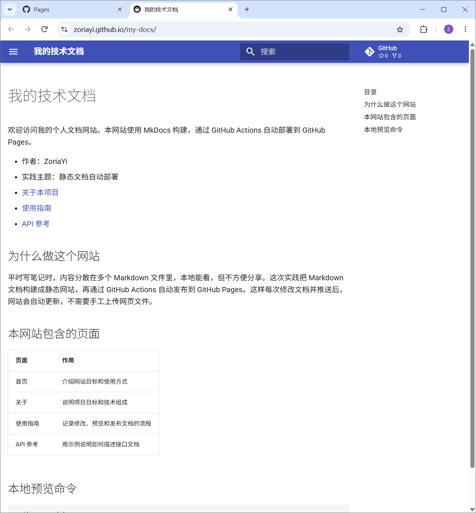
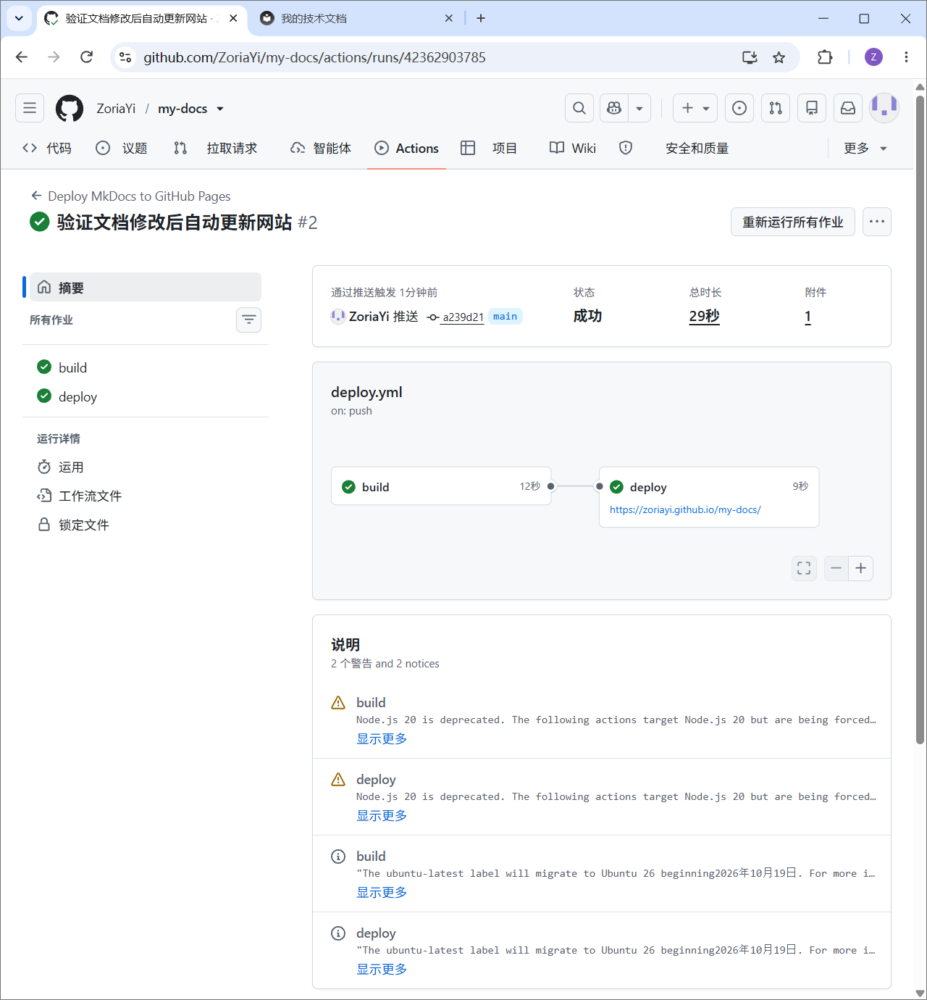
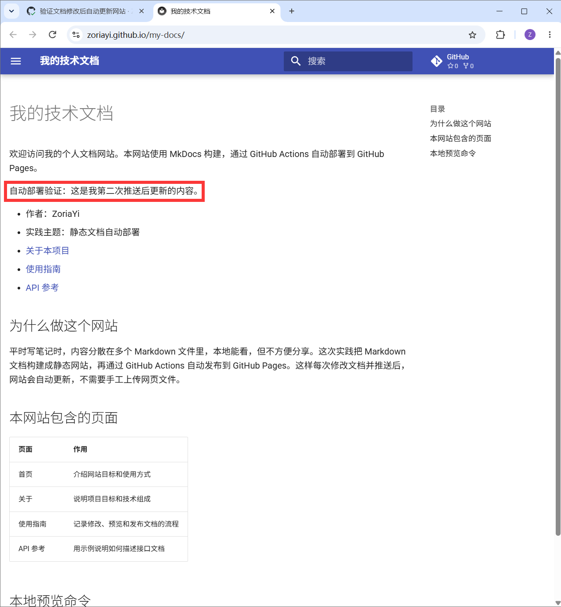

# 实践项目2：个人实验报告

## 1. 基本信息

- GitHub 登录名：ZoriaYi
- 个人仓库地址：https://github.com/ZoriaYi/my-docs
- 最终网站地址：https://ZoriaYi.github.io/my-docs/

## 2. 实践过程与关键截图

### 2.1 仓库创建

我在 GitHub 上使用自己的账号创建了一个名为 `my-docs` 的公开仓库，并勾选了初始化 README 文件。创建完成后，我在本地克隆了该仓库，并确认默认分支为 `main`。

**操作与结果：** 成功创建公开仓库，本地克隆成功，默认分支为 `main`。

### 2.2 项目结构与 MkDocs 配置

我在项目根目录创建了标准结构，包含 `.github/workflows/`、`docs/`、`report/`、`mkdocs.yml` 等核心文件。

**操作与结果：** 配置了 `docs/` 作为源文件目录，`mkdocs.yml` 定义了导航，`.gitignore` 忽略了构建产物 `site/` 和虚拟环境 `.venv/`。

### 2.3 本地构建或预览

我激活了 Python 虚拟环境，安装了依赖，并执行了 `python -m mkdocs build --strict` 进行构建。

**操作与结果：** 构建成功，随后用 `python -m mkdocs serve` 启动本地预览。我逐页检查了导航、表格、代码块和页面间链接，确认均显示正常。

### 2.4 Pages 设置

在仓库的 Settings → Pages 中，我将 Build and deployment 的 Source 从默认的“Deploy from a branch”修改为了“GitHub Actions”。

**操作与结果：** 页面顶部提示“GitHub Pages 源已保存”，说明配置成功。

### 2.5 Actions 首次构建和部署

我编写了 `.github/workflows/deploy.yml`，并提交推送到 `main` 分支。推送后，我进入仓库的 Actions 页面查看运行状态。

**操作与结果：** `Deploy MkDocs to GitHub Pages` 工作流被自动触发，`build` 和 `deploy` 两个任务均顺利完成（绿色对勾）。

### 2.6 网站访问与四页导航检查

部署成功后，我访问了网站地址 `https://ZoriaYi.github.io/my-docs/`。

**操作与结果：** 首页、关于、使用指南、API 参考四页均能正常打开，导航栏切换流畅，表格和代码块渲染正确。

### 2.7 第二次推送与自动更新验证

我修改了 `docs/index.md`，增加了一句明显文字，然后提交并推送到 `main` 分支。

**操作与结果：** 没有手动点击部署，推送后自动触发了新的 Actions 运行并成功。刷新网页后，新文字成功显示。说明自动构建和部署链路完全通畅。

- 对应提交链接：https://github.com/ZoriaYi/my-docs/commit/你的第二次提交哈希值
- 对应 Actions 运行链接：https://github.com/ZoriaYi/my-docs/actions/runs/你的运行ID

## 3. 问题与解决

在实践过程中，我遇到了两个主要问题并成功解决：

1. **本地安装依赖时网络报错**：执行 `pip install -r requirements.txt` 时报 `SSLEOFError`。通过查阅资料，我发现这是网络原因导致无法直连 PyPI 官方源，随后改用清华大学镜像源 `-i https://pypi.tuna.tsinghua.edu.cn/simple` 后成功安装。
2. **`.gitignore` 未生效**：在第一次检查 `git status` 时，发现 `.venv/` 和 `site/` 显示为未跟踪文件。排查发现是新建 `.gitignore` 文件时误操作。我删除了错误文件，重新创建 `.gitignore` 并正确写入 `site/`、`.venv/` 和 `__pycache__/`，最终 Git 成功忽略了这些构建产物和虚拟环境。

## 4. 原理理解

1. **`docs/` 和 `site/` 各保存什么？为什么不用手工修改 `site/`？**
   - `docs/` 保存的是纯 Markdown 源文件，是网站真正的内容来源；`site/` 是 MkDocs 将 Markdown 渲染生成的静态 HTML/CSS 文件。
   - 不应该手工修改 `site/`，因为每次执行构建命令时，它都会被重新生成并覆盖。修改源文件才是正确的做法。

2. **本次工作流在什么情况下自动运行？**
   - 根据 `deploy.yml` 的配置，当向 `main` 分支推送（push）代码，并且修改了 `docs/` 目录、`mkdocs.yml`、`requirements.txt` 或工作流文件本身时，会自动触发运行。另外，我也可以通过手动点击 `workflow_dispatch` 按钮手动触发。

3. **`build` 与 `deploy` 两个任务有什么区别？**
   - `build` 负责获取源码、安装依赖、执行构建命令，并将生成的 `site/` 文件作为 Artifact 上传。
   - `deploy` 负责下载构建产物，并将其正式发布到 GitHub Pages 服务器上。

4. **只修改 `report/README.md` 会触发部署吗？为什么？**
   - 不会。因为 `deploy.yml` 的 `paths` 过滤器限定了只监控 `docs/**`、`mkdocs.yml`、`requirements.txt` 等路径。修改 `report/` 目录的文件不在这个规则内，因此不会触发部署。

5. **本次方案为何无需创建 `gh-pages` 分支？**
   - 因为本方案使用的是 GitHub 官方推荐的 Actions 部署方案。它通过 `upload-pages-artifact` 上传构建产物，并利用 `deploy-pages` 直接推送到 Pages 环境，不需要生成 `gh-pages` 分支。
